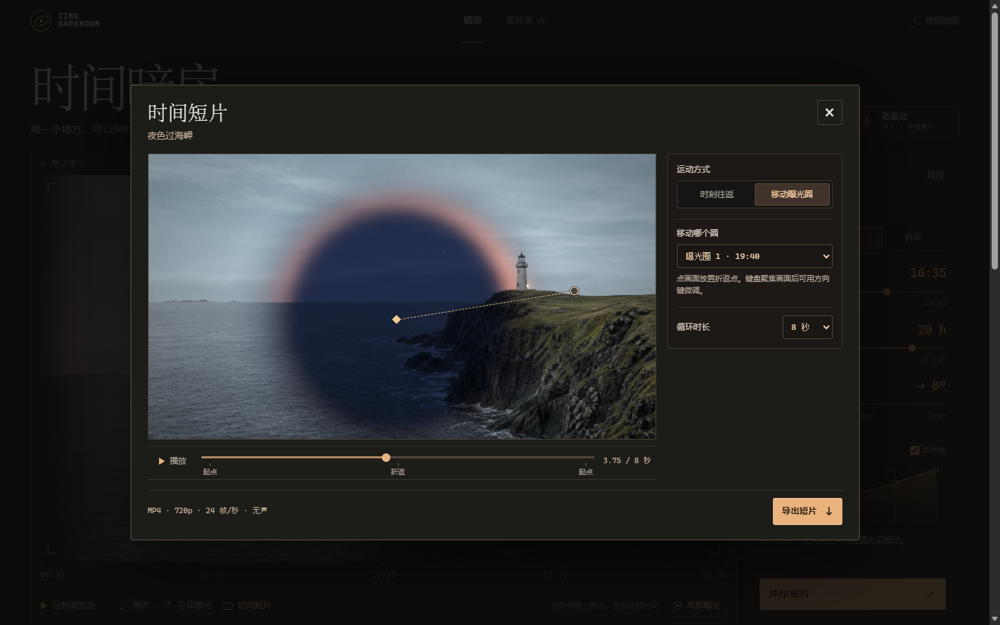

# 时间暗房 / Time Darkroom

在岬角灯塔和镜湖，清晨、白昼和深夜可以被冲印在同一张照片上。

[进入在线暗房](https://17timg-bit.github.io/time-darkroom/) · [打开取景台](https://17timg-bit.github.io/time-darkroom/#field) · [播放短片示例](https://17timg-bit.github.io/time-darkroom/#film) · [版本记录](CHANGELOG.md)

双击 **打开时间暗房.html**。建议用启用了 WebGL 的 Edge 或 Chrome。项目可以离线运行，移动时把整个文件夹一起带走。

## 试玩

1. **拖动五个亮点。** 它们分别控制从曝光起点到终点的五个取样时刻。先把中间的亮点拖到顶端，看看夜色如何进入画面。取景框下方的刻度会随之变化。
2. **切换同刻、扫过、折回。** 同刻让整张照片回到同一分钟；扫过让时间从左到右推进；折回从两侧出发，在中间折返。中心时刻可以拨过午夜。
3. **转动曝光方向。** 0° 是从左到右，90° 是从天空到海面。可以先打开底片夹里的「海面已经天亮」，再慢慢转动角度，观察晨光扫过海岬。
4. **带着同一条曲线换个取景地。** 在顶部选择镜湖。底片「湖里仍是昨夜」让白昼的天空与夜晚的倒影同框。
5. **换一天看看天象。** 点取景框右上角的「天象」，可以改观测日期，查看日月升落和当前月相。建议用「同刻」缓慢拖时刻，观察日月经过固定镜头。
6. **让时间流动，再冲印。** 岬角有海声，镜湖有湖风。按「冲印底片」将这一刻加入底片夹，最多保存 12 张自制底片。点击底片夹里的缩略图即可取回曝光参数。
7. **留下或分享这次曝光。** 从底片夹导出 2000 × 1350 PNG，印样会标注观测日期、取景地、五处取样时刻和曝光方向。点「分享曝光」，对方可以在在线暗房打开同一画面继续修改。

用方向键微调已聚焦的曲线节点，按住 Shift 可大步调整。在未聚焦控件时，空格播放或暂停，P 冲印。

## 局部曝光

打开取景框下方的「局部曝光」，在画面上点一下，或者按「添加一处」。拖动圈心移动，设定这一处的时刻。半径以取景框高度为单位，羽化是从边缘向内过渡的宽度，占半径的百分比。点选下方的区域按钮可在最多三处局部曝光之间切换，重叠处以后加入的一圈为先。圈心也可以用方向键微调，按住 Shift 移动更远。

内置景片的局部时刻以当前观测日为准。羽化在基础时刻和局部时刻之间插值，然后按各处的时间计算天光、星月和取样照片。取景框下方的五个刻度是基础曲线的时刻。收起编辑后，移动取样线可读到该点合成后的时刻。

多张照片的胶卷沿已覆盖的时段过渡。比如 18:00 和次日 02:00 的原片会在午夜附近衔接；超出采样时段时使用最近的一端。

局部曝光随底片保存。内置景片可用链接一起分享。冲印 PNG 保留成像与局部时刻，编辑辅助线仅显示在暗房。

## 时间短片

从取景框下方点「时间短片」。选「时刻往返」可调整折返时刻，原画面的曲线和方向会一起带进来。画面已有局部曝光时，可以选「移动曝光圈」，再点画面指定折返点。聚焦预览后，方向键可微调折返点。拖动播放条或用方向键逐帧查看。

时长可选 6、8 或 12 秒。短片从当前曝光缓慢出发，在折返点减速，再回到起点。导出以 1280 × 720、24 帧/秒逐帧编码为无声 MP4，浏览器支持 WebM 时可用作替代。导出在当前浏览器完成，图像辅助线只出现在编辑器。使用 Commons 景片的短片也保留画面署名和完整来源元数据。CC BY-SA 衍生短片按相同许可分享。

[打开《夜色过海岬》](https://17timg-bit.github.io/time-darkroom/#film) · [下载八秒样片](预览/时间短片%20-%20夜色过海岬.mp4)



## 用自己的照片创作

- **取景台 → 本地胶卷**接受 1–6 张 JPG、PNG、WebP 或 AVIF，每张最多 25 MB。JPEG 有拍摄时间时会预填，可自行修正。没有拍摄时刻的单张以 12:00 为原片锚点。
- **同机位连曝**适合用同一机位、焦距和构图拍的素材。缩放后拖动画面，用第一张当参考。填好每张的不同拍摄时刻后带入暗房。「柔接」混合相邻原片，「切片」选最近的原片。自动采用覆盖素材的最短昼夜区间，区间外取最近端的原片。
- **单张推演**改变明暗和色调。内置景片的日月星空另由两处固定参考站计算。
- **世界漫游**按地名与光线筛选 [Wikimedia Commons](https://commons.wikimedia.org/) 景片。搜索词用于找图，拍摄时间来自记录或你手填。原片署名可从胶卷与暗房查看，PNG 带可见署名与完整 Attribution 元数据。使用 CC BY-SA 图像公开衍生印样时，须按相同许可分享。
- 你的照片和胶卷只在当前浏览器存储。取景台保留最近编辑的胶卷，已冲印的底片保有各自独立素材快照。自带景片通过 PNG 分享。

## 文件结构

```text
时间暗房/
├── 打开时间暗房.html    双击进入暗房
├── index.html          GitHub Pages 入口
├── README.md
├── CHANGELOG.md        版本记录
├── assets/
│   ├── cape.js         岬角灯塔景片与遮罩
│   ├── lake.js         镜湖景片与遮罩
│   ├── stars.js        真实星表的离线投影纹理
│   └── moon.js         离线月面反照率纹理
├── src/
│   ├── darkroom.css    界面与不同窗口的布局
│   ├── darkroom.js     曝光台、底片夹、海声和 PNG 冲印
│   ├── optics.js       时间映射与 WebGL 成像
│   ├── sky.js          天文历表、镜头投影和月相
│   ├── field.js        原片导入、校片素材和本地存储
│   ├── field-desk.js   取景台与 Commons 检索
│   ├── field.css       取景台版式
│   ├── local-exposure.js  局部曝光编辑
│   ├── local-exposure.css 局部曝光编辑版式
│   ├── film.js         短片预览与逐帧导出
│   └── film.css        短片编辑器版式
├── vendor/             Astronomy Engine、Mediabunny 及许可
├── docs/
│   ├── 景片来源.md      两幅原始景片的生成方式和提示词
│   └── 天象模型.md      参考站、天象来源和模型范围
├── scripts/
│   ├── sync-entry.mjs  从离线入口同步在线入口
│   └── build-sky-assets.py  重建星图与月面纹理
└── 预览/
    ├── 暗房预览.png
    ├── 窄屏预览.png
    ├── 局部曝光.png
    ├── 时间短片.png
    ├── 时间短片 - 夜色过海岬.mp4
    ├── 天象-月相.png
    ├── 取景台.png
    ├── 时间暗房 - 一天穿过海岬.png
    ├── 时间暗房 - 海面已经天亮.png
    ├── 时间暗房 - 灯塔先入夜.png
    └── 时间暗房 - 湖里仍是昨夜.png
```

两处取景地都是虚构景片。曝光曲线控制每处画面取样的时刻，日月星空按观测日期及参考站计算，再投进固定镜头。完整说明和来源见[天象模型](docs/天象模型.md)。

自制底片保存在当前浏览器与入口下。离线和在线试玩可以各自保有底片。内置景片的「分享曝光」链接支持从离线入口带入在线暗房。

在独立的 Edge 浏览器配置中打开离线入口，实际检查了鼠标拖动和键盘调节、播放与暂停、海声启动、底片保存与取回、删除取消及确认、PNG 下载，以及 320–1920 像素宽的八组窗口。移动端布局使用浏览器尺寸模拟。

## 第三方组件

- Astronomy Engine 的 MIT 许可见 [Astronomy-Engine-LICENSE.txt](vendor/Astronomy-Engine-LICENSE.txt)。
- 短片面板在本地加载 Mediabunny 1.66.1，使用其原版浏览器包。对应的 [Mediabunny 源码](https://github.com/Vanilagy/mediabunny/tree/134f1e29299ab4bb7e8609bb712c7166ca2c7496)和 [MPL 2.0 许可](vendor/Mediabunny-LICENSE.txt)可直接查看。
